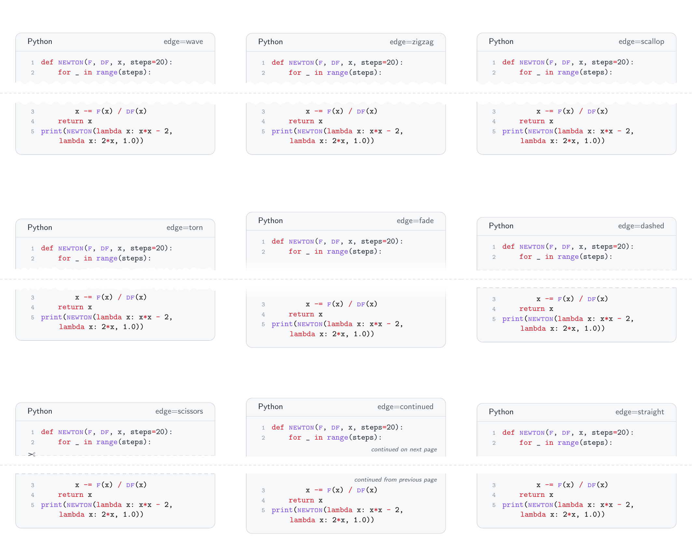
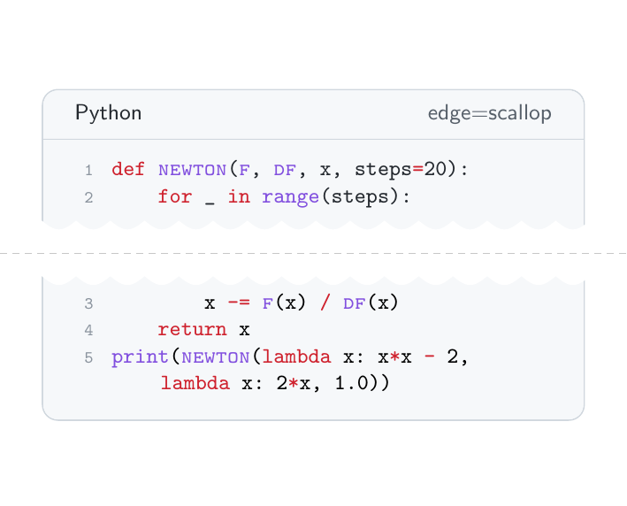
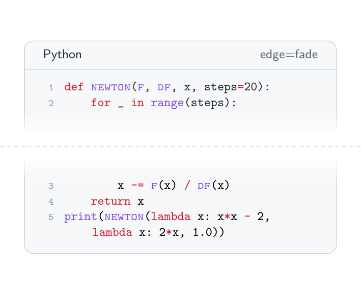
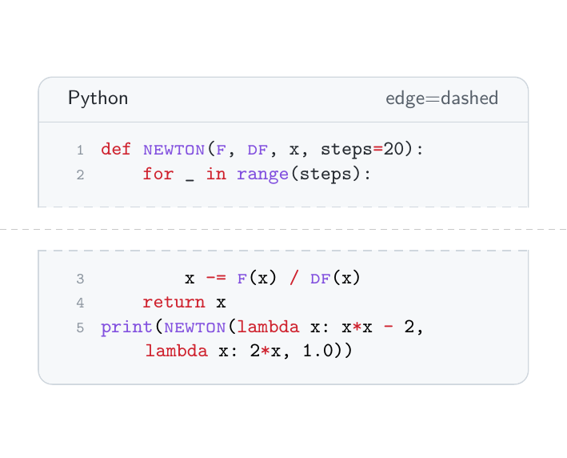
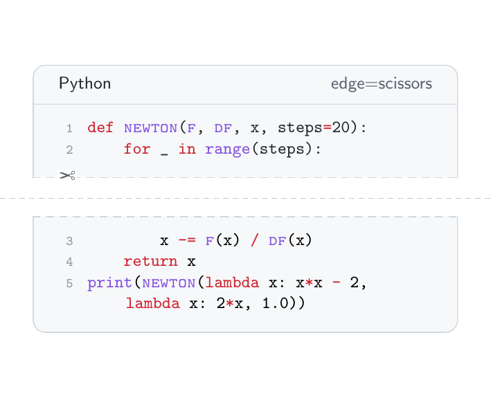
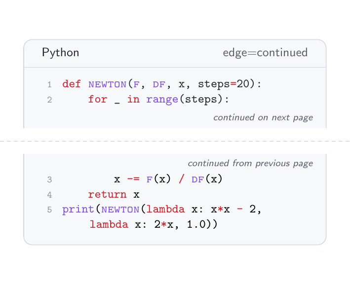
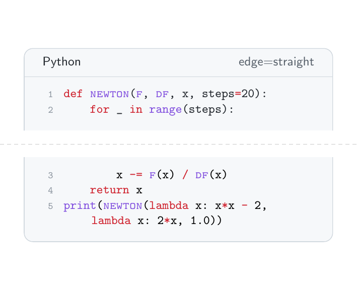

# latex-pro command reference

Every command, environment, option and setting in the library, on one page.
Press **Ctrl+F** (⌘F on a Mac) and type the command name, e.g. `\hessian` or
`filename`, to jump to it.

The per-module pages in this folder ([matrix](matrix.md),
[calculus](calculus.md), [code](code.md), [links](links.md),
[theorems](theorems.md), [sets](sets.md), [notation](notation.md)) have
more background and notes; this page is the quick lookup.

**Reading the signatures.** `{…}` is a required argument, `[…]` an optional
one, and `*` a starred form (`\python*`). An empty optional argument, `[]`,
always means "use the default".

## Contents

- [Loading the library](#loading-the-library)
- [Index of every command](#index-of-every-command)
- [Matrices and vectors](#matrices-and-vectors) (`latex-pro-matrix`)
- [Derivatives](#derivatives) (`latex-pro-calculus`)
- [Code and pseudocode](#code-and-pseudocode) (`latex-pro-code`)
- [QR codes of links](#qr-codes-of-links) (`latex-pro-links`)
- [Theorems and references](#theorems-and-references) (`latex-pro-theorems`)
- [Sets](#sets) (`latex-pro-sets`)
- [General notation](#general-notation) (`latex-pro-notation`)
- [All settings in one place](#all-settings-in-one-place)

---

## Loading the library

```latex
\usepackage{latex-pro}                    % everything
\usepackage[square,bysection]{latex-pro}  % with options
\usepackage{latex-pro-matrix}             % or just one module
```

| Package option | Effect | Default |
| --- | --- | --- |
| `round` | matrix commands use round brackets ( ) | ✓ |
| `square` | matrix commands use square brackets [ ] | |
| `bysection` | theorems are numbered per section: 2.1, 2.2, … | off (1, 2, 3, …) |
| `edge=style` | default [edge style](#split-edge-styles) of code blocks split by a page break | `wave` |
| any other code block option with `=` | a default for every code block, e.g. `length=2` (see [`\latexprocodesetup`](#latexprocodesetup)) | |

Every module can be loaded on its own: `latex-pro-matrix` (accepts
`square`/`round`), `latex-pro-calculus` (also loads `latex-pro-matrix`),
`latex-pro-code` (accepts `edge=…` and the other code block options), `latex-pro-links`, `latex-pro-theorems` (accepts
`bysection`), `latex-pro-sets`, `latex-pro-notation`. See the
[README](../README.md#install) for installing the files once for every
project.

---

## Index of every command

Alphabetical. The link goes to the full entry.

| Command | What it does | Module |
| --- | --- | --- |
| `\abs{x}` | absolute value \|x\| | [notation](#abs-and-norm) |
| `\argmin`, `\argmax` | arg min / arg max operators | [notation](#argmin-and-argmax) |
| `\ball{v}{r}` | open ball B(v, r) | [sets](#ball-dist-interior-bd) |
| `\bd{S}` | boundary ∂S | [sets](#ball-dist-interior-bd) |
| `\bmat{…}` | matrix in square brackets | [matrix](#bmat-pmat-mat) |
| `\bookchapter{…}` | "Chapter 4" reference | [theorems](#booksection-bookchapter-bookeq) |
| `\bookeq{…}` | "Equation (3.12)" reference | [theorems](#booksection-bookchapter-bookeq) |
| `\booksection{…}` | "Section 2.3" reference | [theorems](#booksection-bookchapter-bookeq) |
| `\colvec[x]{n}` | column vector | [matrix](#colvec-and-rowvec) |
| `corollary` | theorem-like environment / reference | [theorems](#theorem-environments) |
| `\defeq` | := | [notation](#small-symbols-tp-defeq-map) |
| `definition` | theorem-like environment / reference | [theorems](#theorem-environments) |
| `\diagmat{…}` | diagonal matrix from a list | [matrix](#diagmat) |
| `\diff[f]{x}` | ordinary derivative df/dx | [calculus](#diff) |
| `\dist{u}{v}` | distance d(u, v) | [sets](#ball-dist-interior-bd) |
| `example` | theorem-like environment / reference | [theorems](#theorem-environments) |
| `exercise` | theorem-like environment / reference | [theorems](#theorem-environments) |
| `\genmat[a]{m}{n}` | general m×n matrix | [matrix](#genmat) |
| `\gradient[x][f][v]{n}` | gradient row vector | [calculus](#gradient) |
| `\hessian[x][f][v]{n}` | Hessian matrix | [calculus](#hessian) |
| `\idmat{n}` | identity matrix | [matrix](#idmat) |
| `\inner{u}{v}` | inner product ⟨u, v⟩ | [notation](#inner) |
| `\interior{S}` | interior S° | [sets](#ball-dist-interior-bd) |
| `\jacobian[x][f][v]{m}{n}` | derivative (Jacobian) matrix | [calculus](#jacobian) |
| `lemma` | theorem-like environment / reference | [theorems](#theorem-environments) |
| `\latexprocodesetup{edge=…}` | default options of code blocks, e.g. the split edge style | [code](#latexprocodesetup) |
| `\map{f}{S}{T}` | f : S → T | [notation](#small-symbols-tp-defeq-map) |
| `\mat{…}` | matrix in the current bracket style | [matrix](#bmat-pmat-mat) |
| `\maximize{…}{…}` | max with stacked constraints | [notation](#minimize-and-maximize) |
| `\method{name}` | function name in the text, styled like in code | [code](#method) |
| `\latexprohyphenname{name}` | a hyphenated name in pseudocode, printed in one piece (used by `\pseudo`) | [code](#pseudo-file) |
| `\variable{name}` | variable in the text, written as in pseudocode | [code](#variable) |
| `\minimize{…}{…}` | min with stacked constraints | [notation](#minimize-and-maximize) |
| `\N` `\Z` `\Q` `\R` | ℕ ℤ ℚ ℝ | [sets](#number-sets) |
| `\norm{x}` | norm ‖x‖ | [notation](#abs-and-norm) |
| `\partialdiff[f]{x,y}` | partial derivative | [calculus](#partialdiff) |
| `\pmat{…}` | matrix in round brackets | [matrix](#bmat-pmat-mat) |
| `proposition` | theorem-like environment / reference | [theorems](#theorem-environments) |
| `\pseudo[opts]{file.txt}` | pseudocode from a file | [code](#pseudo-file) |
| `pseudo`, `pseudo*`, `pseudocode` | pseudocode typed in the `.tex` file | [code](#pseudo-environment) |
| `\pseudoindentfalse`, `\pseudoindenttrue` | turn automatic pseudocode indentation off / on | [code](#pseudoindentfalse) |
| `\py{…}` | inline Python | [code](#py) |
| `\python[opts]{file.py}` | Python from a file | [code](#python) |
| `pythoncode` | Python typed in the `.tex` file | [code](#pythoncode) |
| `\qr[size]{link}`, `\qr*` | QR code of a link | [links](#qr) |
| `\qrsetsize{size}` | default QR code size | [links](#qrsetsize) |
| `remark` | theorem-like environment / reference | [theorems](#theorem-environments) |
| `\rowvec[x]{n}` | row vector | [matrix](#colvec-and-rowvec) |
| `\Rx`, `\Rx[t]` | polynomial ring ℝ[x] | [sets](#rx) |
| `\set{…}` | set {1, 2, 3} | [sets](#set-and-setof) |
| `\setpartialdifffunction{g}` | default function of `\partialdiff` | [calculus](#setpartialdifffunction) |
| `\setof{…}{…}` | set builder {x ∈ S \| p(x)} | [sets](#set-and-setof) |
| `\symmat[a]{n}` | symmetric / diagonal matrix | [matrix](#symmat) |
| `theorem` | theorem-like environment / reference | [theorems](#theorem-environments) |
| `\tp` | transpose ᵀ | [notation](#small-symbols-tp-defeq-map) |
| `\usematb`, `\usematp` | switch to square / round brackets | [matrix](#usematb-and-usematp) |

---

## Matrices and vectors

Module `latex-pro-matrix`. All built-in matrix commands (here and in the
calculus module) follow the current bracket style. A **number** as size
writes every entry out; anything else (`n`, `m`, …) gives the general form
with ⋯ ⋮ ⋱.

### `\bmat`, `\pmat`, `\mat`

`\bmat{rows}` · `\pmat{rows}` · `\mat{rows}`

| Argument | Meaning |
| --- | --- |
| `rows` | matrix body, `&` between entries, `\\` between rows |

`\bmat` always uses square brackets, `\pmat` always round, and `\mat` the
current style (round unless changed).

```latex
\bmat{1 & 2 \\ 3 & 4}   % [1 2; 3 4]
\mat{a & b \\ c & d}    % (a b; c d), or [ ] after \usematb
```

### `\usematb` and `\usematp`

`\usematb` · `\usematp`

Switch `\mat` and every matrix command to square (`b`) or round (`p`)
brackets from that point on. Inside a group `{\usematb …}` the change stays
local. Same as the package options `square` / `round`.

```latex
\usematb                 % square brackets from here
{\usematp \idmat{2}}     % round just for this one
```

### `\idmat`

`\idmat{n}`

| Argument | Meaning |
| --- | --- |
| `n` | size; a number writes it out, a letter gives the general form |

```latex
\idmat{3}   % 3×3 identity
\idmat{n}   % general n×n identity with dots
```

### `\colvec` and `\rowvec`

`\colvec[name]{n}` · `\colvec[list]` · `\rowvec[name]{n}` · `\rowvec[list]`

| Argument | Meaning | Default |
| --- | --- | --- |
| `[name]` | entry symbol, gives name₁, …, nameₙ | `x` |
| `[list]` | comma list of the exact entries (no `{n}` needed) | |
| `{n}` | length (number or letter) | |

A row vector given as a list is printed with commas: (x, y).

```latex
\colvec{n}          % (x_1, …, x_n) as a column
\colvec[v]{3}       % v_1, v_2, v_3
\colvec[x, y, z]    % exactly x, y, z
\rowvec[w]{4}       % [w_1 w_2 w_3 w_4]
\rowvec[1, 2]       % (1, 2)
```

### `\genmat`

`\genmat[name]{m}{n}`

| Argument | Meaning | Default |
| --- | --- | --- |
| `[name]` | entry symbol, gives nameᵢⱼ | `a` |
| `{m}` | number of rows | |
| `{n}` | number of columns | |

```latex
\genmat{m}{n}       % general m×n matrix a_ij
\genmat[b]{2}{3}    % 2×3 with entries b_ij
```

### `\symmat`

`\symmat[name]{n}` · `\symmat{rows}` · `\symmat[list]{n}`

| Form | Result |
| --- | --- |
| `\symmat{n}`, `\symmat[s]{3}` | general symmetric matrix, aᵢⱼ on/above the diagonal and mirrored below (default name `a`) |
| `\symmat{e & 0 \\ 0 & d}` | symmetric matrix from all its rows |
| `\symmat{1 & 2 & 3 \\ 4 & 5 \\ 6}` | symmetric matrix from only its upper triangle (diagonal included) |
| `\symmat[e,d]{2}` | diagonal matrix with e, d on the diagonal, 0 elsewhere |
| `\symmat[d_1,d_2,d_n]{n}` | general diagonal matrix (give the entries for rows 1, 2 and n) |

### `\diagmat`

`\diagmat{list}`

Diagonal matrix with the listed entries; the size is the length of the list.
Same as `\symmat[list]{size}`.

```latex
\diagmat{e, d}       % diag(e, d)
\diagmat{1, 2, 3}
```

---

## Derivatives

Module `latex-pro-calculus` (loads `latex-pro-matrix`, so the bracket style
applies to the matrices below).

### `\partialdiff`

`\partialdiff[function]{variables}`

| Argument | Meaning | Default |
| --- | --- | --- |
| `[function]` | what is differentiated; `[]` gives the operator ∂/∂x | `f` (see `\setpartialdifffunction`) |
| `{variables}` | comma list of variables | |

Consecutive repeats collapse to powers and the total order goes on ∂ in the
numerator; non-consecutive repeats keep your order.

```latex
\partialdiff[f]{x}       % ∂f/∂x
\partialdiff[f]{x,y}     % ∂²f/∂x∂y
\partialdiff[f]{x,x,y}   % ∂³f/∂x²∂y
\partialdiff{y}          % ∂f/∂y  (default function)
\partialdiff[]{t}        % ∂/∂t   (operator)
```

### `\setpartialdifffunction`

`\setpartialdifffunction{function}`

Sets the function `\partialdiff` uses when no `[function]` is given (default
`f`). It lasts until the end of the current group or environment;
`\setpartialdifffunction{}` makes `\partialdiff{t}` the operator ∂/∂t.

```latex
\setpartialdifffunction{g}
\partialdiff{y}          % ∂g/∂y
\partialdiff[h]{y}       % ∂h/∂y  (an explicit function still wins)
```

### `\diff`

`\diff[function]{variables}`

Same rules as `\partialdiff`, with an upright d (ordinary derivative).

```latex
\diff[f]{x}     % df/dx
\diff[f]{x,x}   % d²f/dx²
```

### `\hessian`

`\hessian[variables][function][point]{n}` · `\hessian*[variables][function]{n}`

| Argument | Meaning | Default |
| --- | --- | --- |
| `[variables]` | one symbol (`y` → y₁…yₙ) or a list (`x,y,z` → exactly those) | `x` |
| `[function]` | function name | `f` |
| `[point]` | point of evaluation | `v` |
| `*` | leave the point out: entries ∂²f/∂xᵢ∂xⱼ | |
| `{n}` | dimension (number or letter); with a variable list `{}` is enough | |

Leave an option empty to keep its default: `\hessian[][g]{5}`,
`\hessian[][][\mathbf a]{2}`.

```latex
\hessian{3}                       % 3×3 Hessian of f at v, written out
\hessian{n}                       % general n×n with dots
\hessian[y][g]{n}                 % of g in y_1..y_n
\hessian[x,y]{}                   % in the variables x and y
\hessian[x][f][\mathbf{a}]{2}     % at the point a
\hessian*{2}                      % no point
```

### `\gradient`

`\gradient[variables][function][point]{n}` · `\gradient*…`

Options exactly as for [`\hessian`](#hessian). Gives the row vector
(∂f(v)/∂x₁ ⋯ ∂f(v)/∂xₙ), as in the IMO26 notes.

```latex
\gradient{3}
\gradient*[y][g]{n}
\gradient[x,y,z]{}
```

### `\jacobian`

`\jacobian[variables][function][point]{m}{n}` · `\jacobian*…`

Options as for [`\hessian`](#hessian). `{m}` = number of component
functions (rows), `{n}` = number of variables (columns, or `{}` with a
variable list). Entries ∂fᵢ(v)/∂xⱼ.

```latex
\jacobian{2}{3}        % 2×3 derivative matrix f'(v)
\jacobian[x,y]{2}{}    % 2×2 in the variables x, y
\jacobian*{m}{n}       % general, no point
```

---

## Code and pseudocode

Module `latex-pro-code`. Works with plain `pdflatex`, no `-shell-escape`.
File paths are relative to the main `.tex` file. Every block is an
IDE-style rounded box with a header bar naming the language on the left and
the caption or file name on the right.

### Options for code blocks

These go in `[opts]` of `\python`, `\pseudo`, `pythoncode` and `pseudo`.

| Option | Effect | Default |
| --- | --- | --- |
| `caption={text}` | text on the right of the header bar (replaces the file name) | file name (files), nothing (environments) |
| `title={text}` | same as `caption` | |
| `filename=false` | hide the file name in the header bar | `true` |
| `span` | let the box break across pages, even a short one (split edges are drawn in the box's edge style, wave by default) | `auto`: kept in one piece unless it is taller than a page, then it breaks across pages |
| `span=false` | never break, even a box taller than a page | |
| `edge=style` | how the edges look where a page break splits the box: `wave`, `zigzag`, `scallop`, `torn`, `fade`, `dashed`, `scissors`, `continued`, `straight` (see [split edge styles](#split-edge-styles)) | `wave`, or the document default |
| `length=x` | the wave (zigzag, scallop, torn) on a split edge is x times as long | `1` |
| any `listings` option | passed on, e.g. `firstline=10`, `lastline=25`, `numbers=none`, `firstnumber=5` | |

```latex
\python[caption={Newton's method}]{newton.py}
\python[firstline=10, lastline=25]{solve.py}
\pseudo[filename=false, span]{algo.txt}
```

### Split edge styles

Where a page break splits a code box, the bottom edge of one part and the
top edge of the next are drawn in the box's edge style. Pick the default for
the whole document at the top, and change it for one box with `edge=…`:

```latex
\usepackage[edge=zigzag]{latex-pro}     % default for the whole document
\latexprocodesetup{edge=torn}           % or this, anywhere (from here on)
\python[edge=fade]{long.py}             % just this box
\begin{pythoncode}[span, edge=continued] … \end{pythoncode}
```



| Style | Look | The two edges of a break |
| --- | --- | --- |
| `wave` (default) | smooth sine wave, cut out of the box | interlock: where one bulges out the other dips in |
| `zigzag` | sharp teeth, like pinking shears | interlock tooth into gap |
| `scallop` | round lobes with points between them, like a stamp edge | interlock lobe into dip |
| `torn` | irregular jagged edge, like torn paper | interlock (the same tear on both sides) |
| `fade` | the box fades into the page | mirror images |
| `dashed` | dashed line where the border would be, like a perforation | dashes line up |
| `scissors` | dashed line with scissors on the bottom edge | dashes line up |
| `continued` | open straight edge with *continued on next page* / *continued from previous page* | labels on the right |
| `straight` | open straight edge, nothing drawn | |

The cut styles (`wave`, `zigzag`, `scallop`, `torn`) are
`\latexprowaveheight` tall with period `\latexprowavelength` (times
`length=x`). `fade` and `continued` leave a little extra room between the
code and the edge so nothing is covered.

| Style | Preview | Style | Preview |
| --- | --- | --- | --- |
| `wave` |  | `zigzag` |  |
| `scallop` |  | `torn` |  |
| `fade` |  | `dashed` |  |
| `scissors` |  | `continued` |  |
| `straight` |  | | |

### `\latexprocodesetup`

`\latexprocodesetup{options}`

Default options for every later code block (`\python`, `\pseudo`,
`pythoncode`, `pseudo`): any [code block option](#options-for-code-blocks),
most usefully `edge` and `length`. A box's own options still win. Calling it
again adds to (and overrides) the earlier defaults; inside a group it lasts
to the end of the group. A wrong value (`edge=wavy`) is an error right
there. Package options with `=` do the same:
`\usepackage[edge=scallop]{latex-pro}` is `\latexprocodesetup{edge=scallop}`.

```latex
\latexprocodesetup{edge=continued}
\latexprocodesetup{edge=zigzag, length=2}
```

### `\python`

`\python[opts]{file.py}` · `\python*[opts]{file.py}`

Includes a Python file, syntax-highlighted, with line numbers. The star
drops the line numbers. Options: [see above](#options-for-code-blocks).

```latex
\python{code/solve.py}
\python*{solve.py}
```

### `pythoncode`

`\begin{pythoncode}[opts] … \end{pythoncode}` · `\begin{pythoncode*}…`

Python typed straight into the `.tex` file, same look as `\python`; the
star drops the line numbers. There
is no file name, so the header only shows a `caption`.

```latex
\begin{pythoncode}[caption={Squares}]
for i in range(5):
    print(i ** 2)
\end{pythoncode}
```

### `\py`

`\py{code}`

A short piece of Python inline in a sentence: `Call \py{len(xs)} first.`

### `\method`

`\method{name}`

A function or method name in running text, in the same monospace font,
colour and small caps as function names inside the code blocks.
Hyphens are part of the name: `\method{ADD-building-to-SKYLINE}`.

```latex
The procedure \method{merge} combines two sorted lists.
```

### `\variable`

`\variable{name}`

A variable in running text, written as in a pseudocode block: the
monospace code font in the normal text colour. A name with a subscript or
superscript (`A_i`, `a_{n+1}`) is set as maths, as `\pseudo` does.
Hyphens between letters are part of the name (`\variable{left-sum}`,
`\variable{left-sum_i}`); in a subscript such as `a_{n-1}` the `-` before a
digit is still a minus.

```latex
The loop runs while \variable{lo} is at most \variable{hi}; \variable{A_i} is the $i$-th entry.
```

### `\pseudo` (file)

`\pseudo[opts]{file.txt}` · `\pseudo*[opts]{file.txt}`

Includes a plain-text pseudocode file. The star drops the line numbers.
Options: [see above](#options-for-code-blocks). What it does with the text:

- **Keywords** are highlighted (case-insensitive): `function procedure
  algorithm return if then else elseif end for foreach each to downto by
  step do in while repeat until loop break continue and or not true false
  null print input output let call begin …`.
- **Comments:** `// …` (to the end of the line, also after code, e.g.
  `return x // done`) and `/* … */` are grey italic comments. Keywords and
  operators inside a comment are not coloured; maths such as `a <= b` or
  `\alpha` still becomes symbols.
- **Maths:** TeX commands (`\geq`, `\gets`, `\alpha_i^2`) become symbols;
  `<=` `>=` `!=` `<-` `->` `<` `>` `*` become ≤ ≥ ≠ ← → < > ·; `a_i`,
  `a_{n+1}` are set as maths. A line containing `$…$` is left exactly as
  written.
- **Names with hyphens:** a `-` between two letters joins one name, so
  `ADD-building-to-SKYLINE` after `function` (or written as
  `ADD-building-to-SKYLINE(`) is one function name in small caps, like
  `\method{ADD-building-to-SKYLINE}`, and `skyline-with-one` is one variable.
  A `-` before a digit or between spaces (`n-1`, `a - b`) is still a red
  minus, so write `a - b` with spaces when you mean subtraction of two
  variables. (Internally such a name is printed by
  `\latexprohyphenname{name}`; you do not need to type it.)
- **Automatic indentation:** write every line flush left. Lines after
  `function`/`procedure`/`repeat`/`else`, after a line ending in
  `then`/`do`/`:`/`{`, or a `for`/`foreach`/`while`/`if` header are
  indented; `end…`, `else`, `else if`, `until`, `}` step back out.
  One-liners like `if s = 3 then break` don't open a block.

```latex
\pseudo{algorithms/search.txt}
\pseudo[caption={Binary search}]{search.txt}
```

### `pseudo` (environment)

`\begin{pseudo}[opts] … \end{pseudo}` · `\begin{pseudo*}…` ·
`\begin{pseudocode}…` · `\begin{pseudocode*}…`

Pseudocode typed straight into the `.tex` file, handled exactly like
`\pseudo{file}`. The starred forms drop the line numbers; `pseudocode` is
another name for `pseudo`. The header only shows a `caption`.
Every `\begin{pseudo}` needs its own `\end{pseudo}`. If one is missing,
the block runs on into the next one, and the package stops with
"\begin{pseudo} inside a pseudocode block … Is an \end{pseudo} missing
above it?".

```latex
\begin{pseudo}[caption={Merge buildings}]
function merge(A, B)
for i <- 1 to n do
s <- s + a_i
end for
return s
end function
\end{pseudo}
```

### `\pseudoindentfalse`

`\pseudoindentfalse` · `\pseudoindenttrue`

From that point on, keep the file's own indentation instead of indenting
automatically (`\pseudoindenttrue` turns it back on, the default).

---

## QR codes of links

Module `latex-pro-links`. Uses the `qrcode` package, works with `pdflatex`.
Load `hyperref` to make the code and printed link clickable.

### `\qr`

`\qr[size]{link}` · `\qr*[size]{link}`

| Argument | Meaning | Default |
| --- | --- | --- |
| `*` | print the link beneath the code | off |
| `[size]` | height of this code (use `\qrsetsize` to change the default) | `2cm` |
| `{link}` | the link, pasted as is | |

`%` `#` `_` `&` `~` `$` `^` need no escaping, and line breaks inside the
link are ignored. Only inside another command's argument (`\fbox{…}`,
`\footnote{…}`) write `\%` and `\#`.

```latex
\qr{https://example.com/a_b?x=1&y=%20z#top}
\qr*[3cm]{https://example.com}
```

### `\qrsetsize`

`\qrsetsize{size}`

Sets the default QR code height from here on: `\qrsetsize{2.5cm}`.

---

## Theorems and references

Module `latex-pro-theorems`. Package option `bysection` numbers per
section.

### Theorem environments

`\begin{theorem} … \end{theorem}`, and the same for **proposition, lemma,
corollary, definition, exercise, example, remark**.

All share one counter (Theorem 1, Lemma 2, Proposition 3, …). Theorem,
proposition, lemma and corollary are in italic (`plain` style);
definition, exercise and example in upright (`definition` style); remark in
`remark` style. Use `\label` as usual. Remove any `\newtheorem` lines for
these names from your own preamble.

### Theorem references

`\theorem{text}`, `\proposition{text}`, `\lemma{…}`, `\corollary{…}`,
`\definition{…}`, `\exercise{…}`, `\example{…}`, `\remark{…}`

The same name as a command writes a reference: the name in small caps and
the argument in bold, printed as is. For a label of your own document pass
`\Ref*{label}` (a link with `hyperref`) or `\ref{label}`.

```latex
See \theorem{3.2} and \exercise{b} in the notes.  % as is
By \proposition{\Ref*{prop:main}} …               % number of your label
```

### `\booksection`, `\bookchapter`, `\bookeq`

`\booksection{text}` · `\bookchapter{text}` · `\bookeq{text}`

References to the book, in the same style: "Section **2.3**", "Chapter
**4**", "Equation **(3.12)**". The argument is printed as is (`A.2`, `3.1a`,
`b` all work). `\bookeq` adds the parentheses, and `\bookeq{(3.12)}` gives
the same result.

```latex
By \booksection{2.3} and \bookeq{3.12} …
As in \bookeq{\Ref*{eq:main}}.
```

---

## Sets

Module `latex-pro-sets`.

### Number sets

`\N` `\Z` `\Q` `\R` → ℕ ℤ ℚ ℝ.

### `\set` and `\setof`

`\set{elements}` · `\setof{element}{condition}`

`\set*` / `\setof*` grow the braces with the contents; `\set[\big]{…}`
fixes the size.

```latex
\set{1, 2, 3}                 % {1, 2, 3}
\setof{x \in S}{p(x)}         % {x ∈ S | p(x)}
\setof*{x}{\frac{1}{x} > 0}
```

### `\ball`, `\dist`, `\interior`, `\bd`

`\ball{centre}{radius}` → B(v, ε) · `\dist{u}{v}` → d(u, v) ·
`\interior{S}` → S° · `\bd{S}` → ∂S

### `\Rx`

`\Rx[variable]` → polynomials ℝ[x]; default variable `x`, so `\Rx[t]` is ℝ[t].

---

## General notation

Module `latex-pro-notation`.

### `\abs` and `\norm`

`\abs{x}` → |x| · `\norm{x}` → ‖x‖

`\norm*{…}` grows with the contents; `\norm[\big]{…}` fixes the size.

### `\inner`

`\inner{u}{v}` → ⟨u, v⟩ (starred and sized forms as above).

### Small symbols: `\tp`, `\defeq`, `\map`

| Command | Result |
| --- | --- |
| `A\tp` | transpose Aᵀ |
| `x \defeq y` | x := y |
| `\map{f}{\R^n}{\R}` | f : ℝⁿ → ℝ |

### `\argmin` and `\argmax`

`\argmin_{x \in C} f(x)` — the subscript goes underneath in display maths.

### `\minimize` and `\maximize`

`\minimize{objective}{constraints}` · `\maximize{objective}{constraints}`

Constraints are separated by `\\` and stacked under min/max.

```latex
\minimize{f(x)}{x \in \R^n \\ Ax \le b}
\maximize{c\tp x}{x \ge 0}
```

---

## All settings in one place

Put these in the preamble after `\usepackage{latex-pro}` (or anywhere in
the document for the ones marked "from here on").

| Setting | What it changes | Example |
| --- | --- | --- |
| package option `square` / `round` | bracket style of all matrices | `\usepackage[square]{latex-pro}` |
| `\usematb` / `\usematp` | same, from here on | `\usematb` |
| package option `bysection` | theorem numbering 2.1, 2.2, … | `\usepackage[bysection]{latex-pro}` |
| `\<kind>name` | printed name of a theorem kind | `\renewcommand\exercisename{Opgave}` |
| `\booksectionname`, `\bookchaptername`, `\bookeqname` | printed words of the book references | `\renewcommand\booksectionname{Afsnit}` |
| `\latexprorefstyle` | look of the name in references (small caps) | `\renewcommand\latexprorefstyle[1]{\textit{#1}}` |
| `\latexprorefnumstyle` | look of the number in references (bold) | `\renewcommand\latexprorefnumstyle[1]{#1}` |
| `\qrsetsize` | default QR code height, from here on | `\qrsetsize{3cm}` |
| `\setpartialdifffunction` | default function of `\partialdiff`, from here on | `\setpartialdifffunction{g}` |
| `\pseudoindentfalse` / `\pseudoindenttrue` | automatic pseudocode indentation, from here on | `\pseudoindentfalse` |
| `\latexprocodefont` | font of all code: JetBrains Mono with XeLaTeX/LuaLaTeX when it is installed or its `.ttf` files are next to the `.tex` file, otherwise `\ttfamily`; your own `\renewcommand` always wins | `\renewcommand\latexprocodefont{\fontfamily{lmtt}\selectfont}` |
| `\latexprocodemath` | code font inside maths (used for `A_length` in pseudocode and `\variable{A_i}`) | `$\latexprocodemath{A}_{\latexprocodemath{length}}$` |
| package option `edge=…` / `\latexprocodesetup` | default edge style of split code boxes (and any other code block option), from here on | `\latexprocodesetup{edge=torn}` |
| `\latexprowaveheight`, `\latexprowavelength` | height and period of the wavy (zigzag, scallop, torn) edge where a code box is split | `\renewcommand\latexprowaveheight{2.5pt}` |
| `\latexprofadeheight` | how tall the `fade` edge is | `\renewcommand\latexprofadeheight{20pt}` |
| `\latexprocontinuedtext`, `\latexprocontinuedfromtext` | the labels of the `continued` edge | `\renewcommand\latexprocontinuedtext{fortsættes}` |
| `\latexprofunctionfont` | extra font for function names (small caps) | `\renewcommand\latexprofunctionfont{}` (no small caps) |
| `latexpro-code` box style | the tcolorbox of every code block | `\tcbset{latexpro-code/.append style={arc=0pt}}` (square corners) |
| `latexpro-python`, `latexpro-pseudo` listings styles | the listings settings | `\lstdefinestyle{latexpro-python}{…}` |

**Code colours.** Redefine any of these with `\definecolor` in the
preamble, e.g. `\definecolor{latexpro@keyword}{HTML}{D73A49}`:

| Colour | Used for | Default |
| --- | --- | --- |
| `latexpro@codebg` | box and header background | `F6F8FA` |
| `latexpro@pagebg` | page colour, used to cut and fade the split edges (change it on coloured paper) | `white` |
| `latexpro@codeframe` | box frame | `D0D7DE` |
| `latexpro@header` | language name in the header | `24292F` |
| `latexpro@headerinfo` | caption / file name in the header | `57606A` |
| `latexpro@text` | plain code text | `24292F` |
| `latexpro@keyword` | keywords and operators | `CF222E` |
| `latexpro@function` | function names (and `\method`) | `8250DF` |
| `latexpro@builtin` | built-ins such as `print`, `len` | `8250DF` |
| `latexpro@constant` | `True`, `False`, `None`, `self` | `0550AE` |
| `latexpro@string` | strings | `0A3069` |
| `latexpro@comment` | comments | `6E7781` |
| `latexpro@number` | line numbers | `8C959F` |
